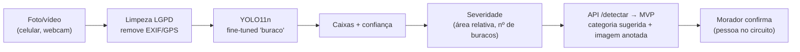

# ZelaCidade · Visão — detecção de buracos em tempo real

> **Global Solution 2026.2 · CitizenTech · FIAP Engenharia de Software 4º ano**
> Disciplina: **Applied Computer Vision** — *Enxergando o mundo real* (Prof. Arnaldo Viana e Paulo Rodrigues)

Componente de **Visão** da ZelaCidade: um detector **YOLO11 treinado de forma customizada** encontra buracos em
fotos e vídeos de vias públicas. No MVP, quando o morador envia a foto de uma ocorrência, a API `/detectar` sugere
a categoria *buraco na via*, estima a severidade e devolve a imagem anotada; o morador confirma antes de registrar.

💻 **Repositório:** <https://github.com/GuiAlves2005/zelacidade-cv>
🎥 **Vídeo de demonstração:** «link do YouTube (não listado)»
📄 **Documento técnico (PDF):** [`docs/relatorio_visao.pdf`](docs/relatorio_visao.pdf)

## Integrantes

| Nome completo | RM |
|---|---|
| Bruno Venturi Lopes Vieira | 99431 |
| Guilherme Alves de Lima | 550433 |
| Leonardo de Oliveira Ruiz | 98901 |

## Resultados

YOLO11n fine-tuned a partir do COCO, 640 px, treinado em 6,4 min numa RTX 5060 Ti 8 GB (95 épocas, parada
antecipada; melhor época 70). Conjunto de **teste**: 67 imagens, 177 buracos, nunca vistos no treino
(`resultados/metricas.md`).

| Conjunto | mAP50 | mAP50-95 | Precisão | Recall | F1 | FPS (RTX 5060 Ti) |
|---|---|---|---|---|---|---|
| Teste | 0,793 | 0,477 | 0,717 | 0,763 | 0,739 | 92,5 (inferência) |

No limiar de confiança do produto (0,35): 120 acertos, 31 falsos positivos e 57 buracos não detectados
(precisão 0,79 · recall 0,68).

**Tempo real** — vídeo de teste `videos/rua.mp4` (1920×1080, 30 fps, 300 quadros), medido com
`scripts/medir_fps.py` em todos os quadros (`resultados/fps_video.json`):

| Medida | ms por quadro | FPS |
|---|---|---|
| Só inferência (pré-processamento + rede + NMS) | 10,8 (p95: 13,0) | 92,5 |
| Pipeline completo (ler 1080p + detectar + desenhar + gravar) | 26,2 | 38,2 |

As duas ficam acima dos 30 fps do vídeo. Vídeo anotado: `resultados/demo.mp4`; quadros de acertos e falsos
positivos (tampa, mancha, sarjeta) em `resultados/quadros_demo/`.

## Como funciona



## Estrutura

```
docs/relatorio_visao.pdf        documento técnico (versão oficial); figuras em docs/figuras/
dados/README.md                 como obter e montar o dataset (Pothole Dataset, Roboflow Public, ODbL v1.0)
scripts/montar_dataset.py       junta fontes YOLO, unifica classe 'buraco', divide 70/20/10
scripts/treinar.py              fine-tuning YOLO11 (Ultralytics)
scripts/avaliar.py              mAP, precisão, recall e F1 no teste; galeria de acertos/erros
scripts/exportar_onnx.py        best.onnx (opset 17, saída bruta [1,5,8400]) + classes.json + config.json + 5 amostras com esperado.json
scripts/tempo_real.py           webcam / vídeo / câmera do celular com caixas, severidade e FPS
scripts/medir_fps.py            FPS em todos os quadros de um vídeo: só inferência e pipeline completo
src/visao/onnx_ref.py           pré/pós-processamento de referência do ONNX (letterbox 114, NMS, desfazer borda)
src/visao/util.py               severidade, limpeza de imagem, conversão de resultados
api/main.py                     POST /detectar consumido pelo MVP
notebooks/                      01 dataset · 02 treino · 03 avaliação · 04 tempo real e API (com saídas salvas)
modelos/buraco.pt               pesos treinados (5,5 MB)
runs/buraco_yolo11n/            curvas de treino (results.png), métricas por época (results.csv), hiperparâmetros (args.yaml)
resultados/                     metricas.md/.json, fps_video.json, curvas do teste (val_teste/), demo.mp4, quadros_demo/
videos/rua.mp4                  vídeo de teste gravado pela equipe (placa desfocada, sem áudio)
tests/                          testes (os de severidade, privacidade e ONNX rodam sem GPU)
requirements.txt                dependências; requirements-lock.txt = versões exatas (pip freeze no Windows)
```


## Como reproduzir

Testado em Windows 10 + RTX 5060 Ti 8 GB + Python 3.11.

```bash
python -m venv .venv && .venv\Scripts\activate
pip install torch torchvision --index-url https://download.pytorch.org/whl/cu128
pip install -r requirements.txt   # ou requirements-lock.txt: versões exatas usadas, congeladas no Windows 10
pytest -q

# dados (ver dados/README.md)
python scripts/montar_dataset.py --fonte dados/brutos/roboflow_pothole:publico --saida dados/zelacidade

# treino, avaliação e tempo real
python scripts/treinar.py --modelo yolo11n.pt --epocas 100 --lote 16
python scripts/avaliar.py --conf 0.35
python scripts/tempo_real.py --fonte 0                     # webcam
python scripts/tempo_real.py --fonte videos/rua.mp4 --gravar resultados/demo.mp4
python scripts/medir_fps.py --fonte videos/rua.mp4        # FPS de inferência e do pipeline completo

# pacote ONNX para o backend do MVP
python scripts/exportar_onnx.py --conf 0.35

# API para o MVP (opcional: set VISAO_API_KEY=... para exigir o cabeçalho X-API-Key)
uvicorn api.main:app --host 0.0.0.0 --port 8002
curl -F "imagem=@foto.jpg;type=image/jpeg" http://localhost:8002/detectar
```

## Responsabilidade e LGPD

- O treino usa só o *Pothole Dataset* público (ODbL v1.0, crédito em `dados/README.md`); as imagens não ficam no Git.
- A API descarta os metadados EXIF (incluindo GPS) da foto, em memória, e não grava imagens em disco. A localização
  da ocorrência vem do mapa, informada pelo morador.
- O vídeo de teste foi gravado pela equipe em rua de São Paulo, apenas para o teste de tempo real (não faz parte do
  treino), com a placa do veículo desfocada e sem áudio.
- A detecção é uma **sugestão**: o morador confirma a categoria e outros moradores podem confirmar a ocorrência.
- A severidade é uma heurística transparente (área relativa ≥ 5% ou ≥ 4 buracos = alta; ≥ 1,5% ou ≥ 2 = média),
  usada só para priorizar a triagem.

## Créditos do dataset

O modelo foi treinado e avaliado com o **Pothole Dataset**, criado por **Atikur Rahman Chitholian**
(<https://github.com/chitholian/Potholes-Detection>), publicado originalmente no Kaggle e redistribuído pelo
**Roboflow Public** (<https://public.roboflow.com/object-detection/pothole>), sob a licença
**ODbL v1.0** (Open Database License).

As imagens desse dataset não ficam no repositório. Este crédito cobre as imagens derivadas dele que aparecem nas
figuras do relatório (`docs/figuras/`) e nas saídas dos notebooks (`notebooks/`).
